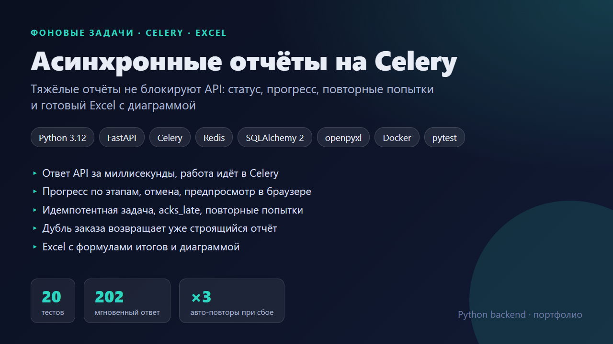
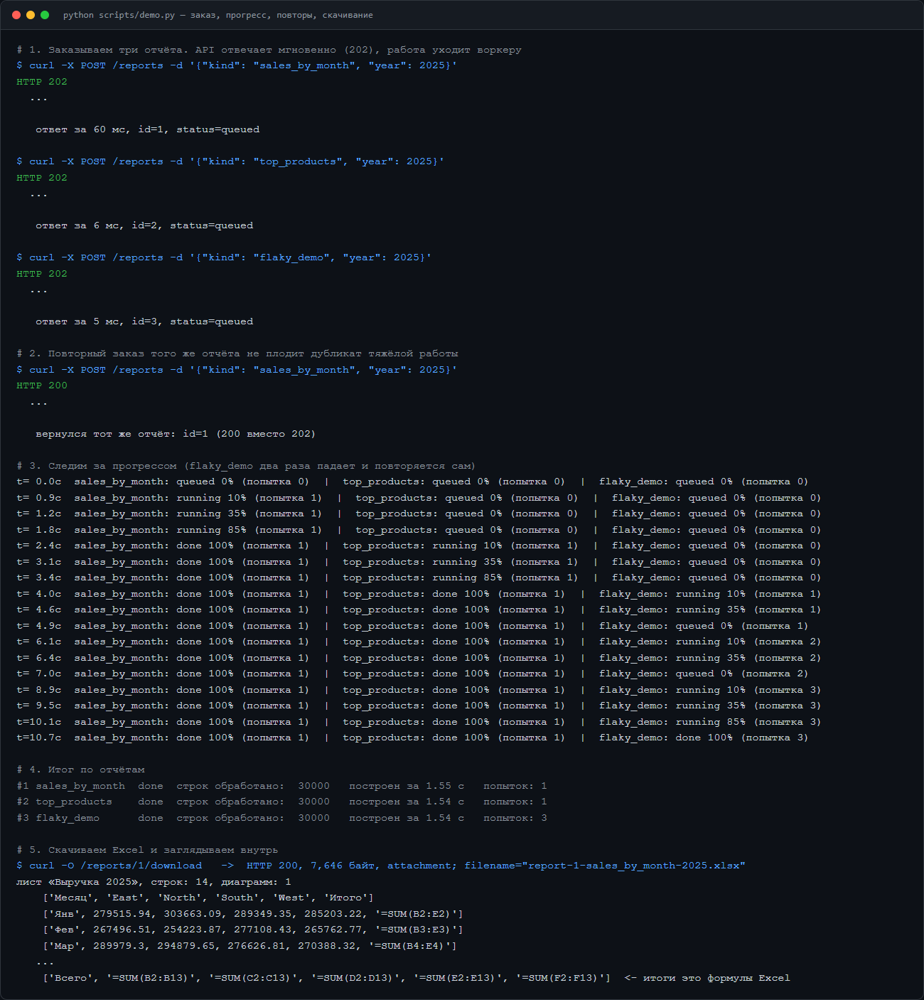
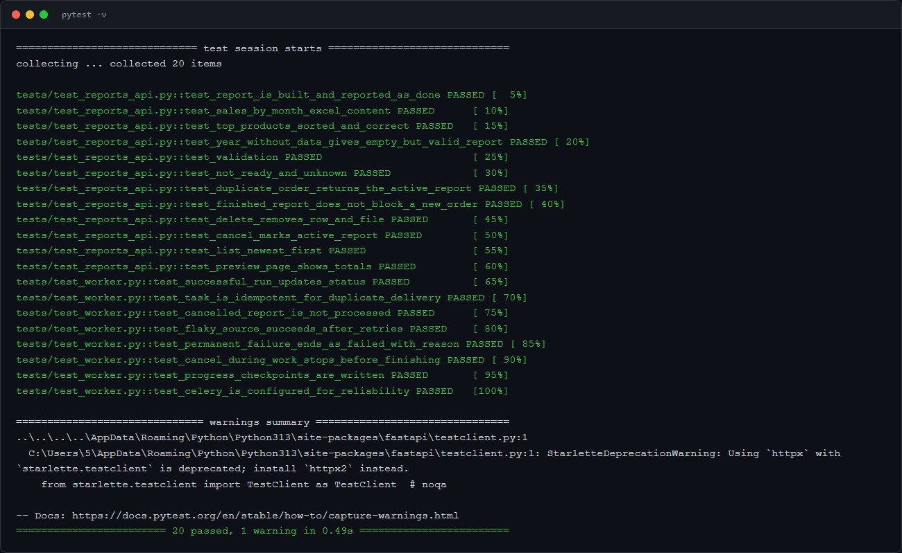

# Асинхронные отчёты на Celery

Тяжёлый отчёт нельзя строить прямо в HTTP-запросе: клиент ждёт, балансировщик рвёт соединение по таймауту, воркеры API заняты. Здесь запрос только ставит задачу в очередь. Excel строит Celery-воркер, а клиент следит за статусом и скачивает файл.



## Как это работает

```
POST /reports ──> запись в БД (queued) ──> Celery ──> воркер
     │ 202 за миллисекунды                               │ 10% → 35% → 85% → 100%
GET /reports/{id}  <── статус, прогресс, попытки ────────┘
GET /reports/{id}/download ──> Excel (формулы итогов + диаграмма)
```

| Задача | Решение |
|---|---|
| Клиент не должен ждать | Ответ `202`, прогресс по этапам, предпросмотр `/preview` |
| Брокер доставил сообщение дважды | Задача идемпотентна: атомарный захват `UPDATE ... WHERE status='queued'`, повторная доставка получает `skipped` |
| Воркер упал на середине | `acks_late`: сообщение подтверждается только после выполнения, поэтому задача вернётся в очередь |
| Источник данных временно недоступен | До 3 повторов с паузой 1, 2, 4 с, затем `failed` с причиной. В демо `flaky_demo` падает дважды и успешно завершается с третьей попытки |
| Пользователь передумал | `DELETE /reports/{id}`: воркер замечает отмену на ближайшей контрольной точке и прекращает работу |
| Нетерпеливый пользователь жмёт «заказать» пять раз | Активный отчёт того же вида возвращается повторно (`200`), дубли тяжёлой работы не создаются |
| 30 000 строк продаж | Агрегаты считает БД (`GROUP BY`), а в Excel попадают итоговые суммы. Итоги записаны формулами `=SUM(...)`, диаграмма встроена |
| Долгие задачи блокируют воркер | `worker_prefetch_multiplier=1`: воркер не забирает задачи про запас |

## Запуск

Одной командой, без Redis и Docker (API + настоящий Celery-воркер на файловом брокере):

```bash
pip install -r requirements.txt
python scripts/dev.py            # http://localhost:8000/docs
python scripts/demo.py           # заказ, прогресс, повторы, скачивание
pytest                           # задачи выполняются синхронно (CELERY_EAGER=1)
```

Полноценный вариант с Redis и PostgreSQL:

```bash
docker compose up --build        # api + worker + redis + postgres
```

## Скриншоты

| Демо-сценарий | Отчёт «Выручка по месяцам» | Топ товаров |
|---|---|---|
|  |  |  |


